# Programador de visitas

Arma el **cronograma mensual** de visitas de un coordinador. Ordena a sus clientes por prioridad (personas, renovación y vencimiento del contrato, criticidad y visitas al mes), los georeferencia (convierte cada dirección en coordenadas), reparte las visitas de cada cliente en las 4 semanas del mes y las agrupa en jornadas diarias de clientes cercanos y ordena cada jornada en el recorrido más corto. Tiene **dos opciones de partida**: *partida libre* (opción B, llamada `v2`, la opción por defecto, con sectorización por localidad y zonas) y *partida definida* desde la casa del coordinador (opción A, llamada `casa`). Además permite reagendar las visitas que no se pudieron hacer.

> [!WARNING]
> **Las direcciones de cada cliente deben estar bien parametrizadas para el correcto funcionamiento del algoritmo.**
> Con una dirección incompleta o ambigua (por ejemplo, sin ciudad) el servicio de georeferencia puede ubicar mal al cliente, y entonces las geocercas, las jornadas y el recorrido óptimo salen mal. Revisa la dirección que el sistema muestra bajo cada cliente.

**¿Qué vas a leer?**

| Si eres... | Ve a... |
|---|---|
| Alguien que quiere entender qué hace el programa, sin tecnicismos | [Explicación sencilla](#explicación-sencilla-para-no-técnicos) |
| Quien lo va a implementar (en el stack que elija) | [Qué es y qué hace](#qué-es-y-qué-hace-versión-técnica), [Entradas y salidas](#entradas-y-salidas) y [Referencia técnica](#referencia-técnica) |
| Quien construirá la reagendación y la pantalla | [Reagendación de visitas](#reagendación-de-visitas) |

> Este documento es una **especificación independiente de la tecnología**: describe reglas, datos, algoritmos y comportamiento esperado. El lenguaje, la base de datos, el framework y el servicio de mapas los elige quien lo implemente.

## Explicación sencilla (para no técnicos)

### La idea en una frase

El programa arma, para un coordinador, el **calendario de visitas del mes**: a quién atender primero, cuántas veces, en qué semana, qué clientes juntos en un mismo día y en qué orden recorrerlos, para gastar el menor tiempo de viaje posible.

### Qué problema resuelve

Un coordinador tiene decenas de clientes y cada uno debe recibir cierto número de visitas al mes. Si se visitan al azar, se pierde tiempo en la calle y se descuida a quien más lo necesita. El programa decide por él.

### Cómo piensa, en 5 pasos

```
  ┌───────────────┐   ┌────────────────┐   ┌────────────────┐   ┌───────────────┐   ┌────────────────┐
  │ 1. ¿QUIÉN LO  │ → │ 2. ¿CUÁNTAS    │ → │ 3. ¿EN QUÉ     │ → │ 4. ¿QUÉ       │ → │ 5. ¿EN QUÉ     │
  │    NECESITA   │   │    VECES?      │   │    SEMANA?     │   │    CLIENTES   │   │    ORDEN?      │
  │    MÁS?       │   │                │   │                │   │    JUNTOS?    │   │                │
  └───────────────┘   └────────────────┘   └────────────────┘   └───────────────┘   └────────────────┘
   Se le da una         Cada cliente        Las visitas se       Los clientes que     Dentro de cada día
   "nota de urgencia"   recibe exactamente   reparten parejo      quedan cerca entre   se elige el camino
   a cada cliente       las visitas que     en las 4 semanas     sí se agrupan en     más corto para no
                        tiene definidas                          el mismo día         perder tiempo
```

### 1. La nota de urgencia

Cada cliente recibe una nota que se arma así:

```
   Visitas al mes ÷ clientes del coordinador     →  el "peso" de partida
   + 0.50 si es crítico · + 0.25 si es estable · − 0.25 si es excelente
   × más personas en el cliente                  →  sube la nota
   × 1.5 si no renueva solo y el contrato
         está por vencer (≤ 2 meses)             →  sube la nota a la mitad
```

Un cliente con varias de estas cosas a la vez sube mucho más que uno con una sola. **Los de nota mayor a 1 son urgentes y se programan en los primeros días, aunque estén lejos.** Los de nota 1 o menos se acomodan después, junto a los clientes más cercanos a ellos.

**Visitas por llamada.** Si en el Operation Planner el cliente tiene **0.25 visitas semanales** (una al mes), el coordinador puede cumplirla **por llamada**: ese cliente no entra al cronograma de ruta y se lista aparte.

### 2. Qué se agrupa en un día

```
         Cliente urgente (el día se arma a su alrededor)
                   ●───●     Los que están dentro de ~500 m
                  /     \    se visitan el mismo día
                 ●   ○   ●
                         ○ ← este está lejos: va otro día
```

Cada día lleva **mínimo 3 visitas**, sin máximo. Un mismo cliente nunca se repite el mismo día.

### 4. Prioridad y orden del recorrido son cosas distintas

El programa hace dos preguntas por separado:

```
  PREGUNTA 1: ¿QUÉ DÍA?                       PREGUNTA 2: ¿EN QUÉ ORDEN DENTRO DEL DÍA?
  La decide la URGENCIA                        La decide la DISTANCIA
  ───────────────────                          ──────────────────────
  Los clientes más urgentes caen               Dentro de un día ya definido, las paradas se
  en los primeros días de la semana,           ordenan para recorrer el camino más corto,
  y el día se arma alrededor de ellos.         sin importar quién es más urgente.
```

Por eso **el cliente más urgente siempre queda en uno de los primeros días, pero no siempre es la primera parada de ese día**. Ejemplo de un mismo día con 4 clientes (A es el más urgente):

```
  Clientes del día:  A (urgente)   B   C   D        Ubicación en la calle:  B ── C ── A ── D

  Ordenados por urgencia:  A → B → C → D   ✗ recorre de más (va y vuelve)
  Ordenado por recorrido:  B → C → A → D   ✓ camino más corto; A se visita el mismo día, en 3.ª parada
```

Como todas las visitas de ese día se hacen igual, visitar a A en 3.ª posición en lugar de 1.ª no lo retrasa: lo atiende el mismo día. Lo que sí importa es que el día de A sea de los primeros.

### 3. Qué se entrega

```
  SEMANA 1
    Día 1:  Cliente A → Cliente B → Cliente C → Cliente D
    Día 2:  Cliente E → Cliente F → Cliente G
  SEMANA 2
    Día 1:  ...
  (4 semanas, cada una con sus días)
```

Cada visita muestra la dirección que entendió el servicio de mapas y la distancia desde la visita anterior.

### Los algoritmos, en dibujos

**1. La nota de urgencia.** La nota sale de las visitas del cliente (más un ajuste por criticidad), multiplicada por personas y renovación; mientras más factores, más arriba queda.

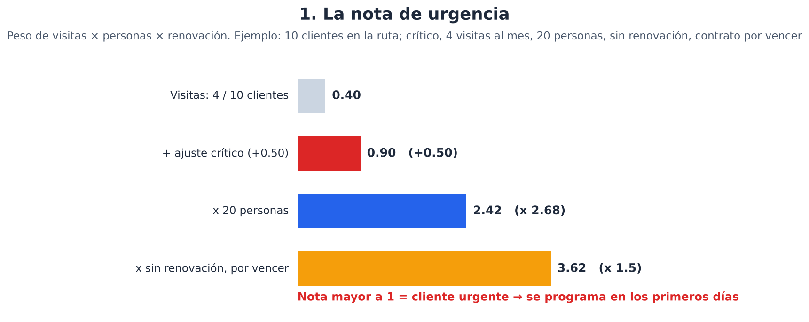

**2. Qué día.** La lista de prioridad reparte a los clientes en los días: los más urgentes caen en los primeros.

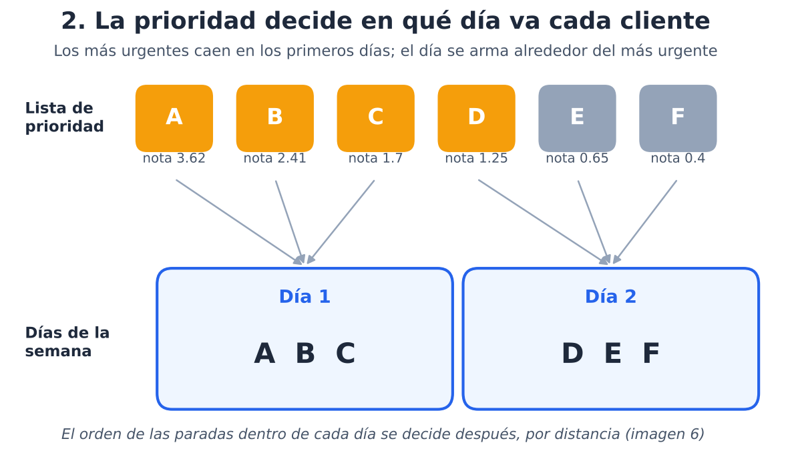

**3. Las visitas del mes.** Cada cliente recibe exactamente las visitas que tiene definidas, repartidas en las 4 semanas.

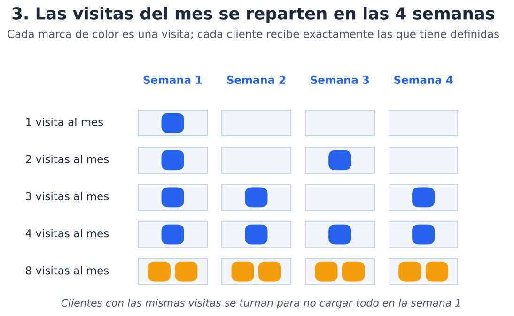

**4. Qué clientes van juntos.** El día se arma alrededor del cliente más urgente y solo suma a los que están a 500 m o menos (después de completar el mínimo de 3).

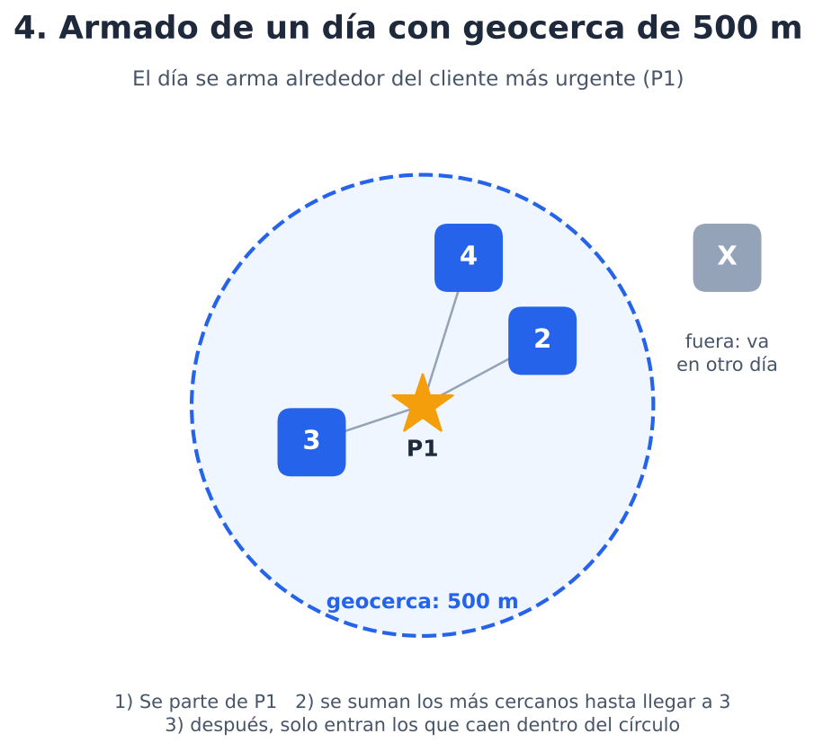

**5. El camino más corto.** Con los clientes del día ya definidos, el programa busca el orden de recorrido que menos tiempo gasta.

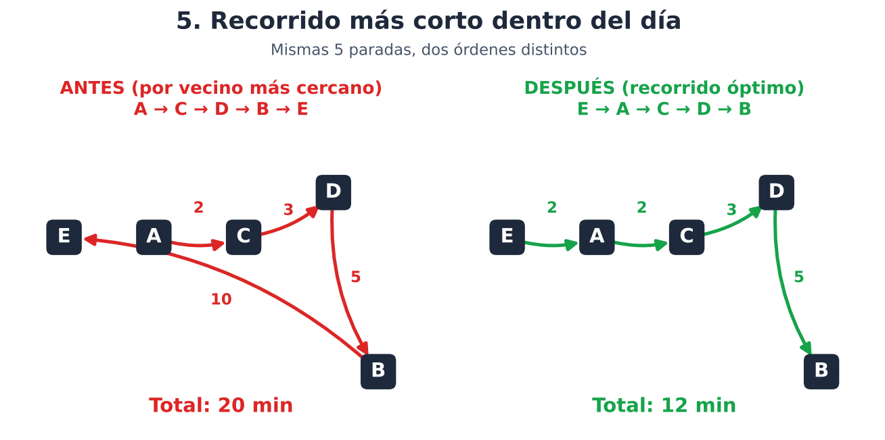

**6. Prioridad no es orden de recorrido.** La urgencia decide el día; la distancia decide el orden dentro del día. Por eso el cliente más urgente siempre queda en uno de los primeros días, pero no siempre es la primera parada.

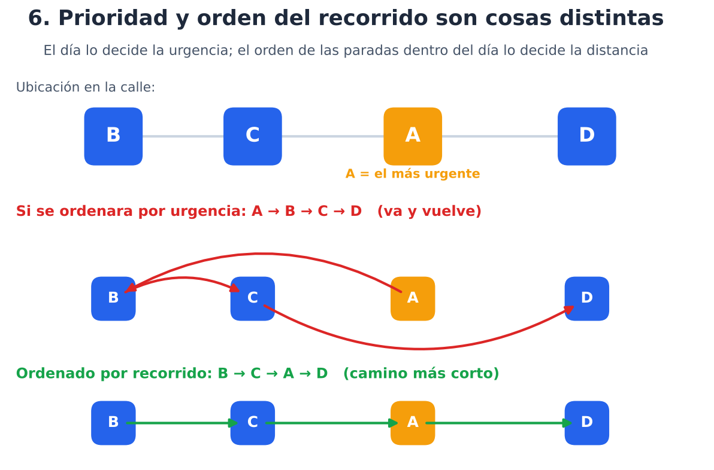

**7. Localidades y zonas (opción B).** Los clientes se separan por localidad de Bogotá (o por municipio, si están fuera). Dentro de la localidad, los clientes que quedan a 1-50 m entre sí (mismo edificio, conjunto o sede) forman una zona y siempre se visitan juntos.

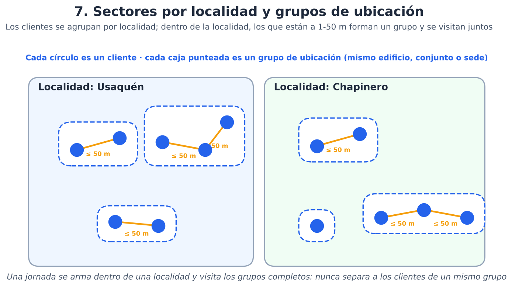

**8. Reagendar una visita que no se pudo hacer.** Si el cliente es crítico y tiene más de 4 personas, se reagenda de inmediato. En cualquier otro caso se crea una solicitud tipo PQR y la directora recibe un correo para aceptarla o rechazarla, escribiendo siempre la razón.

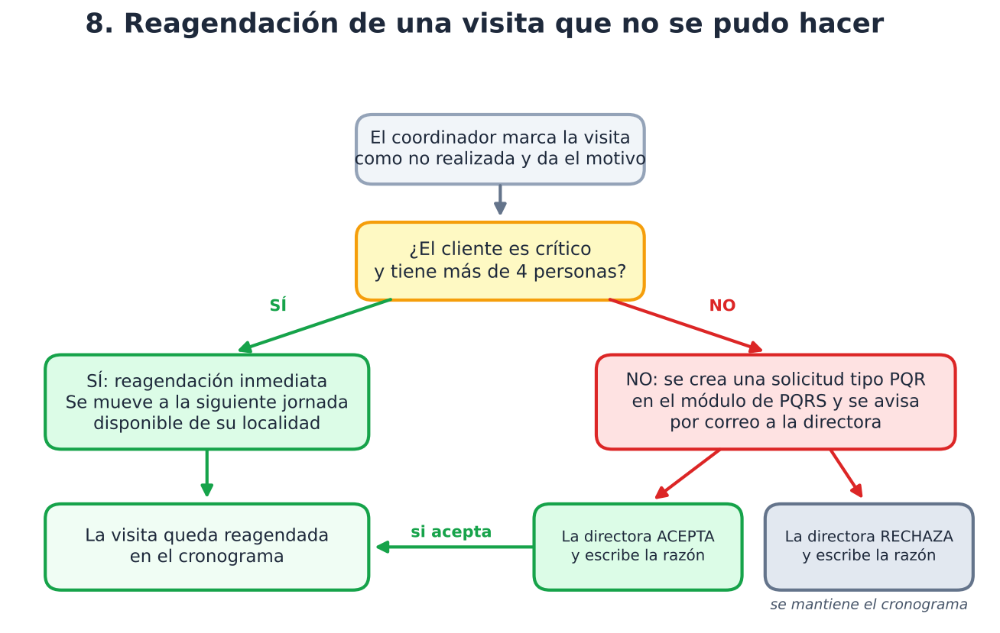

### Dos opciones de partida

El sistema ofrece dos maneras de generar el cronograma. En las dos, el día se arma igual (por urgencia y cercanía); lo que cambia es **desde dónde empieza el recorrido**:

| | Opción A: partida definida | Opción B: partida libre (por defecto) |
|---|---|---|
| Desde dónde empieza el día | Desde la **casa** del coordinador | Desde el punto de la jornada **más conveniente** (el que deja el recorrido más corto); no hay punto fijo |
| Qué más hace | Cuenta el viaje de la casa a la primera visita | Separa a los clientes por **localidad** y **zonas** (1-50 m) |
| Qué necesita | La dirección de la casa de cada coordinador | Nada extra |
| Cómo se elige | Se selecciona la opción A al generar el cronograma | Es la opción por defecto |

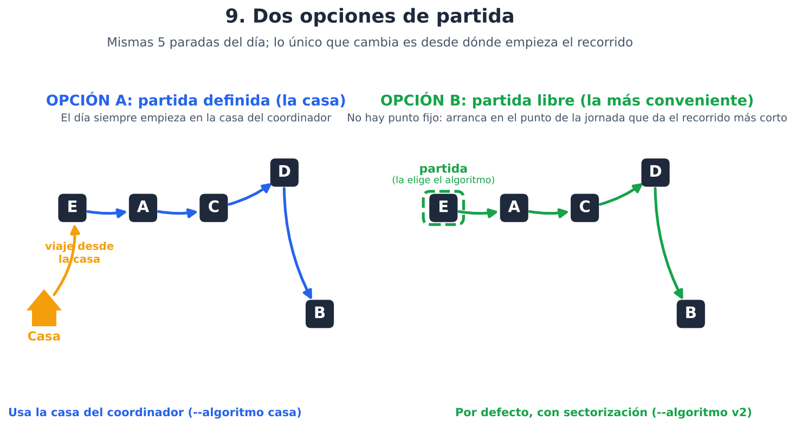

En ninguna opción el coordinador vuelve a casa al final del día. En la opción B, la partida no se sortea ni la fija nadie: el sistema prueba todos los puntos de la jornada como primera parada y se queda con la que hace el recorrido total más corto.

### Qué necesita para funcionar

- El Excel del Operation Planner con los clientes activos y sus datos.
- La tabla de criticidad del mes.
- Un servicio de mapas que convierta direcciones en coordenadas (con su localidad) y entregue tiempos de viaje en coche entre puntos.
- **Direcciones bien escritas**: si la dirección está mal, el cliente se ubica en el lugar equivocado y todo lo demás falla.

### Cuándo se usa

Una vez al mes, la semana antes del día 1. Cada mes que se vuelva a correr, los contratos que se acercan al vencimiento suben de urgencia solos.

### Lo que NO hace

No asigna fechas exactas del calendario (solo "semana 2, día 3"), no calcula cuánto dura cada visita ni cuántas horas tiene el día, y no vuelve a casa al terminar el día. La reagendación está lista como lógica del programa, pero la conexión con el módulo de PQRS y la pantalla (frontend) quedan por construir.

## Qué es y qué hace (versión técnica)

**Objetivo.** Que cada coordinador tenga, para el mes, un plan de visitas a sus clientes que (1) atienda primero a quien más lo necesita y (2) no desperdicie tiempo en desplazamientos, cumpliendo siempre el número de visitas que cada cliente tiene definido.

**Qué recibe.** Solo el nombre de un coordinador (y, opcionalmente, el algoritmo y el día 1 del mes). Con el Operation Planner (Excel), la tabla de criticidad del mes y un servicio de mapas, obtiene todo lo demás.

**Cuándo se corre.** Una vez al mes, la semana anterior al día 1. Los días que faltan para que venza cada contrato se cuentan desde ese día 1, así que al repetir el cálculo cada mes los contratos que se acercan al vencimiento van subiendo de prioridad por sí solos.

**Qué entrega.** Un cronograma de 4 semanas; cada semana es una lista de jornadas diarias; cada jornada es una lista ordenada de visitas (cliente, puntaje, distancia a la visita anterior y dirección que entendió el servicio de mapas).

**Alcance.**

- Sí hace: priorizar, georeferenciar, repartir las visitas del mes en semanas, agrupar en jornadas por cercanía, ordenar cada jornada en el recorrido de menor tiempo de viaje y verificar que cada cliente reciba exactamente sus visitas.
- No hace: programar en ruta a los clientes de 0.25 visitas semanales (se atienden por llamada), asignar fechas de calendario (solo semana y jornada), considerar la duración de las visitas ni las 7 horas de la jornada, hacer que el coordinador vuelva a casa al final del día, combinar casa y sectorización en una misma ejecución (son dos algoritmos separados), ni usar tráfico en tiempo real.
- Pendiente de construir: la conexión real con el módulo de PQRS, el envío del correo a la directora y la pantalla de reagendación (ver "Reagendación de visitas").
- Un coordinador con menos de 3 clientes no se calcula. Un cliente sin visitas definidas no se programa (se avisa).

### Parámetros que tiene en cuenta

| Parámetro | De dónde sale | Para qué se usa |
|---|---|---|
| Cantidad de personas | Excel (`CANT. PERSONAS`) | Más personas, más prioridad (por encima de 3 personas) |
| Renovación automática y vencimiento del contrato | Excel (`RENOVACIÓN AUTOMATICA`, `TIEMPO DE VENCIMIENTO`, `FECHA AL DIA`) | Sin renovación automática y contrato que vence en 2 meses o menos (o venció hace 5 días o menos), hay que acompañar al cliente: sube la prioridad |
| Criticidad (crítico / estable / excelente) | Tabla de criticidad del mes (`cliente, coordinador, criticidad`) | Ajusta el peso de visitas: crítico +0.50, estable +0.25, excelente −0.25 |
| Visitas al mes | Excel (`CANT. VISITAS SEMANALES` × 4) | Peso base = visitas al mes ÷ número de clientes del coordinador en la ruta; además fija cuántas veces se programa. Con 0.25 visitas semanales (1 al mes) el cliente se atiende por llamada y no entra a la ruta |
| Coordinador y estado Activo | Excel | Filtra qué clientes entran |
| Dirección | Excel | Se georeferencia (coordenadas) y se miden tiempos de viaje |
| Tiempos de viaje en coche | Servicio de mapas (tiempos en coche) | Elegir qué clientes se suman a una jornada y calcular el recorrido de menor tiempo |
| Distancia en línea recta | Calculada con las coordenadas | Geocercas: 10 m (mismo punto) y 500 m (máximo de una jornada) |
| Mínimo de visitas por jornada | Parámetro configurable = 3 | Tamaño mínimo de una jornada (no hay máximo) |
| Localidad (sector) | Servicio de georeferencia (sublocalidad de Bogotá o municipio) | Solo algoritmo `v2`: una jornada se arma dentro de una localidad |
| Zonas / grupos de ubicación | Calculados con las coordenadas: clientes encadenados a 1-50 m (parámetro configurable = 50 m) | Solo algoritmo `v2`: los clientes de un grupo se visitan siempre el mismo día |
| Casa del coordinador | Tabla de casas (`coordinador, dirección`) | Solo algoritmo `casa`: punto de partida de cada jornada |
| Criticidad, personas y motivo de la visita no realizada | Cronograma y solicitud de reagendación | Decide si se reagenda de inmediato o con aprobación PQR |

### Cómo lo hace, paso a paso

1. **Carga y filtro.** Lee el Excel, deja los clientes activos del coordinador con dirección y personas, les pone la criticidad de la tabla del mes y calcula los días que faltan para vencer su contrato desde el día 1 del mes a programar.
2. **Georeferencia.** Convierte cada dirección en coordenadas y localidad con el servicio de georeferencia y pide la matriz de tiempos de viaje entre todos sus clientes (y, con la opción A, la casa del coordinador como un punto más).
3. **Puntaje.** Aparta los clientes de 0.25 visitas semanales (se atienden por llamada) y a cada uno del resto le calcula `peso de visitas × personas × renovación`, donde el peso de visitas = visitas al mes ÷ clientes de la ruta + ajuste de criticidad (ver "Cómo decide el orden"). Puntaje mayor a 1 = urgente.
4. **Lista de prioridad (decide qué día).** Primero los urgentes, de mayor a menor puntaje (la prioridad le gana a la distancia); después los de puntaje 1 o menos, cada uno al más cercano del anterior. Esta lista no es el orden de las paradas: solo define en qué jornada cae cada cliente.
5. **Reparto en el mes.** Divide las visitas de cada cliente entre las 4 semanas lo más parejo posible y desfasa los clientes de igual frecuencia para no cargar la semana 1.
6. **Jornadas.** Cada semana se arma en vueltas (un cliente nunca repite el mismo día); cada vuelta se corta en jornadas siguiendo la lista de prioridad: cada jornada se arma alrededor del cliente más urgente que falte (el **ancla**), completa hasta 3 visitas con los más cercanos y por encima de 3 solo suman clientes dentro de 500 m del ancla. **Opción B (`v2`), además:** la jornada se arma dentro de la misma localidad (si no alcanza para 3, se completa con otra) y los clientes de un grupo de ubicación (1-50 m) entran siempre completos.
7. **Recorrido óptimo (decide el orden de las paradas).** Dentro de cada jornada reordena las paradas para minimizar el tiempo de viaje (exacto hasta 12 paradas; mejora por 2-opt si hay más). **Opción A (`casa`):** el recorrido parte de la casa del coordinador (se cuenta el viaje a la 1.ª parada; no vuelve). **Opción B (`v2`):** partida libre, la primera parada es la que deja el recorrido total más corto. Los clientes de la jornada no cambian, solo el orden: **el ancla siempre está en la jornada, pero no necesariamente es la primera parada.**
8. **Reagendación (opcional, bajo demanda).** Si una visita no se pudo hacer, el sistema la mueve a una jornada posterior: inmediata para críticos con más de 4 personas; para el resto, tras la aceptación de la directora en una PQR.
9. **Verificación.** Las pruebas de aceptación deben comprobar que cada cliente reciba exactamente sus visitas del mes, que ninguna jornada repita cliente y que se respeten las reglas de prioridad y geocerca.

### Algoritmos y servicios en los que se apoya

| Pieza | Técnica / servicio |
|---|---|
| Puntaje de prioridad | Modelo de puntuación multiplicativo con pesos y umbral (reglas definidas con el negocio) |
| Lista de prioridad y elección de quién entra a la jornada | Orden por puntaje; **vecino más cercano** (voraz) solo para los de puntaje 1 o menos y para escoger los clientes que completan una jornada. **No** define el orden de las paradas |
| Cliente inicial sin urgentes | Elección del punto más **central** (menor suma de tiempos hacia los demás) |
| Armado de jornadas | Agrupación **voraz** con restricción de radio (**geocerca**) alrededor de la primera parada |
| Recorrido óptimo dentro de la jornada | **Held-Karp** (programación dinámica exacta del problema del viajante, hasta 12 paradas) y **2-opt** (mejora local) si hay más |
| Grupos de ubicación | Encadenamiento por vecino más cercano a ≤ 50 m (equivale a *single-linkage*), con **union-find** |
| Sectorización (opción B) | Partición por localidad del servicio de mapas (clave de agrupación) antes de elegir compañeros de jornada |
| Partida definida (opción A) | **Held-Karp** / 2-opt con costo inicial `salida[i]` (casa → primera parada) |
| Partida libre (opción B) | **Held-Karp** / 2-opt sin costo inicial: prueba todas las primeras paradas |
| Distancia en línea recta | Fórmula de **Haversine** |
| Reparto en semanas | Reparto en cuotas con **redondeo acumulado** (como repartir n elementos en 4 cubetas parejas) y rotación por prioridad |
| Coordenadas | Servicio de georeferencia (ref.: Google Geocoding) |
| Tiempos de viaje | servicio de **matriz de tiempos de viaje** en coche (ref.: Google Routes; por bloques si el servicio limita el tamaño) |

**Por qué no Dijkstra ni A\*.** Esos algoritmos hallan el camino más corto entre dos puntos sobre una red de calles. Eso ya lo resuelve el servicio de mapas al calcular la matriz de tiempos de viaje. Lo que hace falta aquí es otra cosa: en qué *orden* visitar varias paradas (problema del viajante), y para eso se usan Held-Karp y 2-opt sobre esa matriz.

Importante: el vecino más cercano se usa solo para **armar** las jornadas (quién va con quién): da buenos planes rápido, pero no garantiza el mejor reparto de clientes entre jornadas. El **orden de las paradas** dentro de cada jornada lo define otro algoritmo, Held-Karp (óptimo exacto hasta 12 paradas) o 2-opt.

### Pseudocódigo visual

Flujo general (se ve como diagrama en GitHub, VS Code y la mayoría de visores de Markdown):

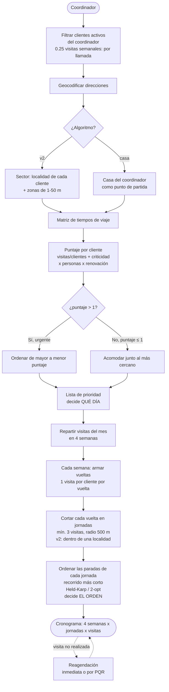

El mismo flujo en pseudocódigo:

```
cronograma(coordinador):
    clientes  = activos del Excel con ese coordinador
    coords    = geocodificar(clientes.direccion)           # (lat, lon, texto, localidad)
    si algoritmo == v2:   ubicacion = encadenar clientes a <= 50 m   # zonas; y la jornada se arma dentro de una localidad
    si algoritmo == casa: casa = casa del coordinador               # sin localidades ni zonas
    tiempos   = matriz_de_tiempos(clientes.direccion)

    llamadas = clientes con 0.25 visitas semanales (1 al mes)   # fuera de la ruta; se atienden por llamada
    clientes = clientes - llamadas
    n = cantidad de clientes

    para cada cliente:
        peso    = max(0, visitas_mes / n + ajuste)        # ajuste: crítico +0.50, estable +0.25, excelente -0.25
        puntaje = peso
                  * (1 + 0.099 * max(0, personas - 3))
                  * (1.5 si NO renueva solo Y vence entre -5 y 60 días, si no 1)

    prioridad = urgentes (puntaje > 1) de mayor a menor      # decide QUÉ DÍA
                + resto (puntaje <= 1) cada uno al más cercano del anterior

    para cada cliente: semanas[c] = repartir(visitas_mes[c], en 4 semanas)

    para cada semana s de 1 a 4:
        para cada vuelta v:                       # 1 visita por cliente
            pendientes = clientes que tocan en s, en orden de prioridad
            mientras queden pendientes:
                ancla = el pendiente de mayor prioridad
                jornada = {ancla (+ su zona, en v2)}            # conjunto, aún sin orden de visita
                mientras len(jornada) < 3:
                    jornada += el más cercano (v2: de la misma localidad, o de cualquiera si no hay) (+ su zona en v2)
                mientras exista pendiente (v2: de la misma localidad) a <= 500 m del ancla:
                    jornada += el más cercano a la última incorporación (+ su zona en v2)
                cerrar jornada
            si la última jornada tiene < 3 visitas: unirla a la anterior

        para cada jornada de la semana:           # recorrido óptimo, mismas paradas
            costo = (minutos casa -> 1.ª parada, solo en algoritmo casa) + minutos entre paradas   # v2: partida libre
            si len(jornada) <= 12: orden = mejor permutación (Held-Karp)
            si no:                 orden = mejorar con 2-opt
            quedarse con el nuevo orden solo si ahorra minutos de viaje
            # el ancla está en la jornada, pero puede no ser la primera parada
```

Ejemplo de una jornada: el círculo es la geocerca de 500 m alrededor del ancla (P1, el cliente más urgente).

```
            .-~~~~~~~~~~~-.
         .'                 '.
        /     (2)---(3)       \
       |       /               |        (X)  fuera del círculo:
       |    [1]  <- primera    |             no entra, queda para
        \   parada            /              otra jornada
         '.                 .'
           '-.._______..-'
```

Lectura: la jornada se arma alrededor del cliente (1) de mayor prioridad, suma los más cercanos hasta llegar a 3 y, si hay más clientes dentro del círculo, también los incluye. Un cliente fuera del círculo no entra. El orden en que se recorren se decide después (ver imagen 5).

Calendario del mes (cada fila es una semana; cada celda, una jornada):

```
            Jornada 1        Jornada 2        Jornada 3       ...
SEMANA 1   [A  B  C  D]     [E  F  G]         [H  I  J]
SEMANA 2   [B  A  C]        [F  E  G  K]      [D  H  I  J]
SEMANA 3   [A  C  B  D]     [E  G  F]         [J  H  I]
SEMANA 4   [C  A  B]        [D  F  E  G]      [H  K  I  J]
             └─ un cliente nunca aparece dos veces en la misma jornada
             └─ cada cliente aparece exactamente tantas veces como visitas tiene al mes
```

## Los algoritmos en imágenes

### 1. Puntaje: peso de visitas × personas × renovación

```
 Cliente: crítico, 4 visitas al mes, 20 personas, sin renovación automática y contrato por vencer
 (el coordinador tiene 10 clientes en la ruta)

  visitas / clientes   4 / 10                   = 0.40
  ajuste criticidad    crítico  + 0.50          → peso 0.90
  personas             x 2.683   (1 + 0.099 x 17)
  renovación           x 1.5
                       ─────────────────────────────────────
  puntaje              0.90 x 2.683 x 1.5 = 3.62   →  urgente (> 1), va primero
```

### 2. Lista de prioridad: define qué día, no el orden de las paradas

```
 Puntaje:   3.62   2.41   1.70   1.25 │ 0.65   0.40   0.25
            ┌────┐ ┌────┐ ┌────┐ ┌────┐│┌────┐ ┌────┐ ┌────┐
 Orden:     │ A  │→│ B  │→│ C  │→│ D  │││ E  │→│ F  │→│ G  │
            └────┘ └────┘ └────┘ └────┘│└────┘ └────┘ └────┘
            ◄── urgentes: por puntaje ──►│◄─ puntaje ≤ 1: cada uno al más
                (la distancia no cuenta) │   cercano del anterior ─►
```

### 3. Reparto de las visitas del mes en 4 semanas

```
 Visitas al mes    Sem 1   Sem 2   Sem 3   Sem 4
      1             ■       ·       ·       ·       (otro cliente con 1 visita arranca en la sem 2, etc.)
      2             ■       ·       ■       ·
      3             ■       ■       ·       ■
      4             ■       ■       ■       ■
      8            ■■      ■■      ■■      ■■
```

### 4. Jornadas con geocerca (500 m)

```
 Paso 1: se toma el cliente de mayor prioridad pendiente como ancla (P1)
 Paso 2: suma los 2 más cercanos aunque estén lejos (hasta llegar a 3)
 Paso 3: solo suma lo que caiga dentro del círculo de 500 m de P1
 Paso 4: se reordenan las paradas del día por el camino más corto (P1 puede quedar en cualquier posición)

              ,-~~~~~~~~~~-.
            ,'   (4)        '.
           /  (P1)───(2)      \          (X) fuera del círculo → otra jornada
          |     \             |
           \     (3)         /
            '.            .'
              '-.______.-'
```

### 5. Recorrido óptimo dentro de la jornada

Ejemplo con 5 paradas (distancias en "minutos" = cuadras en línea recta, para que se pueda seguir a mano):

```
 y=5 │                      D
 y=4 │    E     A     C
 y=3 │ 
 y=2 │ 
 y=1 │                         B
 y=0 │ 
       └──────────────────────────
        0  1  2  3  4  5  6  7  8   ← x   (A=(3,4) B=(8,1) C=(5,4) D=(7,5) E=(1,4))
```

```
 ANTES (orden de armado, tipo vecino más cercano, empezando en A):
   A →2→ C →3→ D →5→ B →10→ E        total = 20 min   (termina volviendo hasta E, que quedó olvidado)

 DESPUÉS (orden óptimo, recorrido abierto):
   E →2→ A →2→ C →3→ D →5→ B         total = 12 min   (empieza por el extremo, sin retroceder)
```

La idea: el vecino más cercano siempre elige lo más cercano *ahora*, y a veces deja una parada aislada para el final, con un salto largo. El orden óptimo mira todas las combinaciones y empieza por el extremo correcto.

Cómo lo calcula (Held-Karp, programación dinámica):

```
 Para cada subconjunto de paradas y cada parada final posible, guarda el mejor costo:

   mejor[{A}, A] = 0                       ← empezar en A cuesta 0
   mejor[{A,B}, B] = mejor[{A}, A] + t(A→B)
   mejor[{A,B,C}, C] = el menor entre
                          mejor[{A,B}, B] + t(B→C)    ← llegar a C desde B
                          mejor[{A,B}, A] + t(A→C)    ← llegar a C desde A
   ... (se repite con subconjuntos cada vez más grandes)
   Resultado = mínimo de mejor[{todas}, última]  →  se reconstruye el orden hacia atrás

 Con 12 paradas son ~590 mil operaciones: instantáneo.
 Con más de 12 se usa 2-opt: se prueba invertir tramos del recorrido y se queda el cambio
 si baja el tiempo, hasta que nada mejora.
```

```
 2-opt: invertir un tramo para quitar un cruce

   antes:  1 → 2 → 3 → 4 → 5        después:  1 → 4 → 3 → 2 → 5
                (tramo 2-3-4)                         (tramo invertido)
```

Garantía: el nuevo orden nunca es peor que el anterior; si no mejora, la jornada queda igual. En pruebas con clientes simulados el recorrido óptimo redujo cerca de un 11 % el tiempo total de viaje del mes.

## Servicios externos necesarios

La especificación necesita dos capacidades externas; el proveedor es libre (la versión de referencia usó Google Maps):

- **Georeferencia:** dirección → coordenadas (latitud, longitud), texto normalizado de la dirección y **localidad** (en Bogotá, la localidad; fuera de Bogotá, el municipio).
- **Matriz de tiempos de viaje:** tiempo en coche, sin tráfico en tiempo real, entre todos los pares de puntos. Si el proveedor limita el tamaño de cada consulta, se parte en bloques.
- Credenciales del proveedor: no se guardan en el repositorio ni en archivos del proyecto; se leen de configuración segura o variables de entorno.

## Entradas y salidas

### Entradas

| Entrada | Obligatoria | Descripción |
|---|---|---|
| Coordinador | Sí | Coordinador del que se arma el cronograma. Se compara sin importar mayúsculas ni tildes. |
| Operation Planner (Excel) | Sí | Fuente de los clientes (ver "Qué lee del Excel"). |
| Tabla de criticidad del mes | Sí | Tabla `cliente, coordinador, criticidad`. |
| Algoritmo | No | `v2` (por defecto): partida libre + sectorización por localidad y zonas. `casa`: partida definida en la casa del coordinador, sin sectorización. |
| Tabla de casas | Solo con `casa` | Tabla `coordinador, dirección`. Si el coordinador no está, la ejecución se detiene y lo informa. |
| Día 1 del mes a programar | No | Desde ahí se cuentan los días que faltan para vencer cada contrato. Por defecto, el próximo día 1 (o hoy, si es día 1). |

Los clientes con 0.25 visitas semanales no entran a la ruta: la salida los lista aparte como "por llamada".

Validaciones: si el coordinador no existe, se informa cuáles hay; si tiene menos de 3 clientes activos, se avisa que no llega al mínimo; si una dirección no se encuentra, se detiene e indica cuál.

### Salida

Un cronograma de 4 semanas, cada una con sus jornadas y, en cada jornada, las visitas en orden de recorrido. Cada visita lleva cliente, puntaje, distancia a la visita anterior con su etiqueta (mismo punto / cerca / lejos), la dirección que entendió el servicio de mapas y, en la opción B, la localidad. En la opción A, la primera parada muestra la distancia desde la casa.

Ejemplo de resultado (ilustrativo; los tiempos dependen del servicio de mapas):

```
Cronograma del mes de Andres Quitian: 15 clientes, 59 visitas (contratos medidos desde el 2026-11-01)
Aviso: sin visitas definidas en el Excel, no se programan: Palatino Jardineria

SEMANA 1: 4 jornadas, 16 visitas
  Jornada 1 (7 visitas)
     1. Navarra  (puntaje 7.819)
        Cra. 8 #170-52, Bogotá, Colombia
     2. Corinto  (puntaje 4.377)  a 292 m del anterior (cerca)
        ...
SEMANA 2: 3 jornadas, 14 visitas
  ...
```

Si una semana tiene más jornadas que días hábiles (5), se marca como "no cabe". Una jornada con menos de 3 visitas se marca como "bajo el mínimo".

## Qué lee del Excel

Hoja `CLIENTES ACTIVOS  2025`:

| Dato | Columna |
|---|---|
| Cliente | `CENTRO DE COSTO` |
| Activo | `STATUS` = Activo (los demás se ignoran) |
| Coordinador | `COORDINADOR` |
| Dirección | `DIRECCIÓN` |
| Personas | `CANT. PERSONAS` |
| Renovación automática | `RENOVACIÓN AUTOMATICA` (SI / NO; vacío cuenta como NO) |
| Visitas al mes | `CANT. VISITAS SEMANALES` × 4 (vacío cuenta como sin dato). Con 0.25 semanales (1 al mes), el cliente se atiende por llamada y no entra a la ruta |
| Vencimiento del contrato | `TIEMPO DE VENCIMIENTO` ("Vence en N días") y `FECHA AL DIA` |

**Fecha de vencimiento.** Sale de la columna `TIEMPO DE VENCIMIENTO` (texto tipo "Vence en 75 días"; negativo = ya vencido). Ese número está calculado a la fecha de `FECHA AL DIA`, así que se recorre hasta el día 1 del mes que se programa. El cronograma se planea la semana anterior al día 1, por eso los días se cuentan siempre desde el día 1 siguiente. Si un cliente sin renovación automática no tiene ese dato, se le mantiene el ×1.5 (no se puede descartar que venza pronto).

Un cliente activo sin coordinador, dirección o personas se excluye, y el programa avisa cuáles.

La criticidad no viene en esa hoja. Viene de la tabla del mes (por ejemplo, la de octubre de 2026), con columnas `cliente, coordinador, criticidad`; valores de criticidad: critico, estable o excelente. Los nombres se comparan sin tildes, puntuación ni espacios. El coordinador siempre sale del Excel, no de la tabla. Cliente sin valor en la tabla: `critico` si figura en la hoja `CRONOGRAMA VISITAS CLIENTES CRI`, si no `estable`.

## Cómo decide el orden

```
peso_visitas = visitas_al_mes ÷ clientes_de_la_ruta + ajuste_criticidad     (nunca menor que 0)
puntaje      = peso_visitas × factor_personas × factor_renovación
```

| Factor | Regla |
|---|---|
| Visitas al mes (`CANT. VISITAS SEMANALES` × 4) | Peso de partida = visitas al mes ÷ número de clientes del coordinador que van en la ruta. Es la base del puntaje: más visitas definidas, más peso |
| Criticidad | Se suma al peso: crítico **+0.50**, estable **+0.25**, excelente **−0.25** (el peso nunca baja de 0) |
| Personas | × (1 + 0.099 por cada persona después de la 3.ª) |
| Renovación | ×1.5 si NO tiene renovación automática **y** su contrato vence en 60 días (2 meses) o menos, contados desde el día 1 del mes que se programa; también si venció hace 5 días o menos. Contrato vencido hace más de 5 días o que vence en más de 60 días: ×1 |

**Visitas por llamada.** Un cliente con **0.25 visitas semanales** (1 visita al mes) en el Operation Planner no entra a la ruta: el coordinador cumple esa visita llamándolo. Se informa en una lista aparte y **no cuenta** en el número de clientes de la ruta.

**Por qué así.** El peso base sale de qué tantas visitas tiene definido el cliente frente al resto de la ruta del coordinador; la criticidad lo corrige hacia arriba (crítico, estable) o hacia abajo (excelente); y las personas y la renovación lo multiplican. Un cliente con varios factores a la vez sube mucho más que uno con un solo factor.

Ejemplos (coordinador con 10 clientes en la ruta, 4 visitas al mes y renovación automática, para ver solo criticidad y personas):

| Cliente | Cálculo | Puntaje |
|---|---|---|
| Excelente, 3 personas | 4/10 − 0.25 | 0.15 |
| Estable, 3 personas | 4/10 + 0.25 | 0.65 |
| Estable, 20 personas | 0.65 × 2.683 | 1.74 (urgente) |
| Crítico, 4 personas | (0.4 + 0.5) × 1.099 | 0.99 |
| **Crítico, 20 personas** | 0.9 × 2.683 | **2.41** |
| Crítico, 20 personas, sin renovación automática y contrato por vencer | 0.9 × 2.683 × 1.5 | 3.62 |

El crítico con 20 personas queda por encima del estable con 20 personas y del crítico con 4. Y como la prioridad le gana a la distancia, ningún cliente cercano de menor puntaje lo adelanta.

**Ojo con el umbral.** Como el peso base es visitas ÷ clientes (casi siempre menor que 1), el puntaje de urgencia (> 1) solo lo superan los clientes con muchas visitas, muchas personas o renovación pendiente. Con la tabla de octubre de 2026 hubo coordinadores con 0 o 1 clientes urgentes; entonces casi toda la ruta se ordena por cercanía. Si se quiere más clientes urgentes, hay que bajar el umbral (parámetro configurable).

Con los puntajes se arma la **lista de prioridad**, que decide en qué jornada cae cada cliente (no el orden de sus paradas):

1. Los clientes con puntaje mayor a 1 son urgentes y van primero en la lista, de mayor a menor puntaje. La distancia no influye entre ellos. Se programan en las primeras jornadas de la semana.
2. Los clientes con puntaje 1 o menos van después en la lista, cada uno al más cercano del anterior.
3. Si ningún cliente es urgente, la lista arranca en el más central (el que suma menos tiempo de viaje hacia los demás).

Todos los valores son **parámetros configurables** (no deben quedar fijos en la lógica):

| Parámetro | Valor |
|---|---|
| Peso por persona sobre 3 | 0.099 |
| Multiplicador de renovación | 1.5 |
| Ventana de renovación (días para vencer) | de −5 (días de gracia) a 60 |
| Ajuste de criticidad al peso de visitas | crítico +0.50 · estable +0.25 · excelente −0.25 |
| Visitas por llamada | 1 visita al mes (0.25 semanales): fuera de la ruta |
| Umbral de urgencia | puntaje > 1 |
| Mínimo de visitas por jornada | 3 |
| Tope del recorrido exacto | 12 paradas |
| Geocerca "mismo punto" | 10 m |
| Distancia máxima dentro de una zona | 50 m |
| Geocerca máxima de la jornada | 500 m |
| Días hábiles por semana | 5 |

## El mes: semanas y visitas por cliente

Cada cliente debe recibir las visitas que tiene definidas al mes (`CANT. VISITAS SEMANALES` × 4). Se reparten en las 4 semanas lo más parejo posible:

| Visitas al mes | Semanas en que se visita |
|---|---|
| 1 | una de las 4 |
| 2 | semanas 1 y 3 (o 2 y 4) |
| 3 | tres de las 4 semanas |
| 4 | una por semana |
| 8 | dos por semana |
| 12 | tres por semana |

Para no cargar todo en la semana 1, los clientes con las mismas visitas se reparten entre las semanas según su prioridad: el cuarto con mayor puntaje arranca en la semana 1, el siguiente cuarto en la 2, y así. Un cliente con 0 visitas definidas no se programa (el programa avisa).

Cada semana se arma por **vueltas**: la 1.ª vuelta es la primera visita de todos los que tocan esa semana, la 2.ª vuelta es la segunda visita de quienes tienen dos esa semana, y cada vuelta se reparte en jornadas por separado. Así un cliente nunca queda dos veces el mismo día. Si una vuelta tiene menos de 3 clientes, se suma a una jornada de la semana donde no estén esos clientes; si no hay, queda como jornada corta.

## Jornadas y geocercas

Dentro de cada vuelta, la lista ordenada por prioridad se reparte en jornadas diarias:

1. La jornada se arma alrededor del **ancla**: el cliente de mayor prioridad que todavía no tenga día.
2. Se le suman los más cercanos (por tiempo de viaje) hasta llegar a **3 visitas**, aunque estén lejos.
3. Pasando de 3, solo se suman los clientes que caigan dentro de la **geocerca**: un círculo de **500 m** alrededor del ancla. Si hay varios, entra el más cercano a la última incorporación. Cuando ya no hay ninguno dentro, la jornada se cierra.
4. Se repite con los que queden. Si la última jornada queda con menos de 3 visitas, se une a la anterior.

Esto es igual en las dos opciones de partida. **Solo en el algoritmo `v2`** se añade la sectorización: los compañeros de jornada salen de la misma localidad (si no alcanza el mínimo de 3, de otra) y los clientes de una misma zona de 1-50 m entran juntos (ver la sección siguiente).

Cada parada muestra la distancia en línea recta a la anterior y su geocerca: **mismo punto** (10 m o menos), **cerca** (hasta 500 m) o **lejos** (más de 500 m). La dirección que entendió el servicio de mapas sale la primera vez que aparece el cliente, para que puedas revisar que lo ubicó bien.

**Orden dentro de la jornada.** Una vez armada la jornada, sus paradas se reordenan para que el recorrido sea el de menor tiempo de viaje (ver imagen 5). Esto no cambia qué clientes van ese día. Con el algoritmo `v2` el recorrido es abierto: la partida es libre y la elige el recorrido más corto. Con el algoritmo `casa`, parte de la casa. En ambos casos **el ancla (el más urgente) siempre está en la jornada, pero puede no ser la primera parada**: la prioridad decide *qué día*, la distancia decide *el orden dentro del día*. La distancia y la geocerca que se imprimen son respecto a la parada anterior del nuevo orden (en la primera parada, respecto a la casa en el algoritmo `casa`).

El calendario tiene semanas y jornadas, **no fechas**: todavía no se asigna cada jornada a un día de calendario.

## Opción B (`v2`): sectorización por localidades y zonas

> Esta sección aplica solo a la opción B (`v2`). La opción A (`casa`) no sectoriza.

El algoritmo `v2` no mezcla zonas de la ciudad en una misma jornada. Trabaja en dos niveles:

```
 Localidad (sector)          →   Grupo de ubicación          →   Jornada
 Usaquén, Chapinero, Cajicá…     clientes a 1-50 m entre sí       se arma dentro de un sector y
 (la devuelve el servicio de mapas)            (mismo edificio/conjunto/sede)   visita grupos completos
```

**Regla de oro: dentro de un grupo de ubicación, cada salto entre dos clientes es de 1 a 50 m.** Los grupos se forman encadenando por vecino más cercano: si A está a 40 m de B y B a 45 m de C, los tres son un grupo aunque A y C estén a 85 m. Dos clientes a más de 50 m no se encadenan. Dos clientes a menos de 1 m (la misma coordenada) se tratan como el mismo punto y también quedan en el mismo grupo.


- **Localidad.** Se toma del servicio de georeferencia: la sublocalidad (en Bogotá, la localidad: Usaquén, Chapinero, Suba…); si no existe, el municipio (Cajicá, Zipaquirá…). Así quedan separados los clientes de Bogotá de los de fuera.
- **Jornada.** Se arma alrededor del ancla con su grupo completo, luego con los más cercanos de su misma localidad. Pasado el mínimo de 3, solo suman clientes de esa localidad a 500 m o menos del ancla. Si la localidad no tiene clientes suficientes para llegar a 3, se completa con los más cercanos de otra (el mínimo de 3 manda).
- **Qué cambia y qué no.** La lista de prioridad sigue decidiendo qué día; la localidad y los grupos solo restringen *con quién* comparte día. El recorrido óptimo dentro de la jornada sigue igual, con partida libre.

## Opción A (`casa`): partida definida en la casa del coordinador

> Esta sección aplica solo a la opción A (`casa`). No sectoriza.

Es el algoritmo de ayer (prioridad, jornadas con geocerca de 500 m y recorrido óptimo) pero con un **punto de partida fijo**: la casa de cada coordinador. Una tabla de casas (`coordinador, dirección`) que hay que llenar para cada coordinador:

```
coordinador,direccion
Juan Roberto,Calle 100 # 15-20 Bogotá
```

- La casa viaja en la misma consulta de tiempos (un punto más de la matriz).
- **Cada jornada sale de la casa:** el recorrido óptimo cuenta el viaje casa → primera parada y elige el orden que minimiza el total; **no vuelve a casa**. El primer cliente del día ya no es necesariamente el extremo de la jornada, sino el más conveniente desde la casa.
- La primera parada muestra la distancia desde la casa ("a 1.250 m de la casa").
- La casa no cambia qué clientes van en cada jornada (eso lo deciden la prioridad y la geocerca), solo el orden de recorrerlos.
- Si el coordinador no aparece en el archivo, la ejecución se detiene y avisa; para ese coordinador se puede usar la opción B.

## Comparación de las dos opciones

| | Opción A: `casa` | Opción B: `v2` (por defecto) |
|---|---|---|
| Partida de cada jornada | Fija: la casa del coordinador | Libre: la primera parada que deja el recorrido más corto |
| Sectorización por localidad | No | Sí |
| Zonas de 1-50 m juntas | No | Sí |
| Prioridad, vencimiento, visitas del mes, geocerca de 500 m, recorrido óptimo | Igual | Igual |
| Datos extra | Archivo de casas | Ninguno |
| Cuándo conviene | El coordinador sale de su casa y quiere minimizar el primer viaje | Se prioriza agrupar por zona y no depender de datos personales |

## Reagendación de visitas

Cuando una visita del cronograma no se pudo hacer (cliente cerrado, vía bloqueada, emergencia…), el coordinador la reagenda. Funciona con **las dos opciones** (A y B): trabaja sobre el cronograma que cualquiera de las dos entrega. Es lógica de backend; la pantalla y la conexión con PQRS están **especificadas más abajo y por construir**.

### Regla

| Cliente | Qué pasa |
|---|---|
| **Crítico y con más de 4 personas** | Reagendación **inmediata**: la visita se mueve en el acto. No hay PQR ni correo. |
| Cualquier otro | Se crea una solicitud de tipo **PQR** en el módulo de PQRS y se envía un **correo a la directora**. La visita no se mueve hasta que la directora la **acepte**, dejando la **razón** (también al rechazar). |

"Más de 4" es estricto: un crítico con exactamente 4 personas pasa por aprobación.


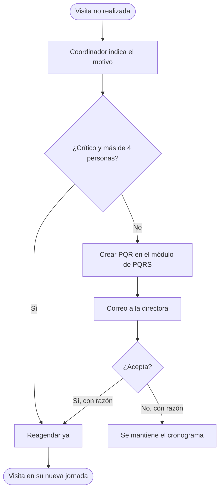


### Dónde cae la visita reagendada

La reagendación mueve la visita a una jornada **posterior** del mes en la que el cliente no esté ya. Prefiere una jornada de **su misma localidad** y, entre esas, la que tenga una parada más cercana. Entra al final de la jornada (su orden óptimo no se recalcula).

| | Opción B (`v2`) | Opción A (`casa`) |
|---|---|---|
| Cómo elige la jornada | Misma localidad primero; luego la parada más cercana | La parada más cercana (no hay localidades) |
| Efecto en la partida | Ninguno (partida libre) | Ninguno: el día sigue saliendo de la casa; la visita entra al final |
| Regla de aprobación (crítico con más de 4 personas / PQR) | Igual | Igual | La operación devuelve el cronograma nuevo (el original no se modifica) y avisos, por ejemplo si la jornada de origen queda por debajo de 3 visitas. Si no quedan jornadas posteriores este mes, falla con un mensaje: la visita pasa al mes siguiente.

### Operaciones

| Operación | Qué hace |
|---|---|
| Requiere aprobación | Falso solo para crítico con más de 4 personas |
| Solicitar reagendación | Punto de entrada del botón "Reagendar" (cronograma, cliente, semana, jornada, motivo, coordinador). Inmediata, o crea la PQR y avisa a la directora. El motivo es obligatorio. |
| Resolver solicitud | Decisión de la directora. La razón es obligatoria; si acepta, mueve la visita. Una solicitud ya resuelta no se puede volver a resolver. |
| Reagendar | Solo mueve la visita |

El módulo de PQRS y el envío de correo son **dependencias externas intercambiables**: la lógica solo necesita poder (1) crear una solicitud y obtener su id, (2) resolverla con estado y razón y (3) enviar un correo a un destinatario con asunto y cuerpo. Para pruebas y demos conviene un sustituto en memoria.

### Integración con el módulo de PQRS (contrato propuesto)

> [!WARNING]
> No conozco la API real del módulo de PQRS. Lo siguiente es una **propuesta** para acordar con quien lo mantiene; hay que ajustarla a la API existente.

| Operación | Propuesta | Datos |
|---|---|---|
| Crear la PQR | `POST /pqrs` | `tipo: "PQR"`, `subtipo: "reagenda_visita"`, `cliente`, `coordinador`, `semana`, `jornada`, `motivo`, `fecha`, `destinatario` → devuelve `id` |
| Resolverla | `PATCH /pqrs/{id}/resolucion` | `estado` (aceptada o rechazada) y `razon` (obligatoria) |
| Bandeja de la directora | `GET /pqrs?tipo=PQR&subtipo=reagenda_visita&estado=pendiente` | lista de solicitudes pendientes |

Debe quedar registrado en el módulo de PQRS: quién solicitó, quién decidió, cuándo, el estado y **la razón de la decisión**. El correo a la directora lleva el id de la PQR, el cliente, la semana y jornada, el motivo y un enlace a la solicitud. La dirección de correo de la directora es un parámetro de configuración, no un valor fijo en la lógica.

### Funcionalidad del frontend (por construir)

**Vista del coordinador: "Mi cronograma"**

- Semanas, jornadas y paradas en el orden de recorrido, con la localidad de cada jornada.
- Cada parada tiene la acción **"No se pudo visitar / Reagendar"**.
- Al pulsarla se abre un formulario con: motivo (lista de motivos + texto libre, **obligatorio**) y un aviso según la regla:
  - Crítico con más de 4 personas: *"Se reagendará de inmediato"*.
  - Otros: *"Requiere aprobación de la directora (se creará una PQR)"*.
- Resultado en la parada: chip **"Reagendada a Semana 2 · Jornada 1"**, o **"Pendiente de aprobación · PQR-0001"**, o **"Reagendación rechazada" más la razón**.
- Mientras una solicitud esté pendiente no se puede solicitar otra para la misma visita.
- Si no hay jornadas posteriores este mes: mensaje "pasa al mes siguiente".

**Vista de la directora: "Solicitudes de reagendación"**

- Bandeja de PQR pendientes (se alimenta del módulo de PQRS).
- Detalle: cliente, criticidad, personas, coordinador, motivo, visita original y **vista previa de la nueva ubicación** en el cronograma.
- Botones **Aceptar** y **Rechazar**, ambos con campo **"Razón" obligatorio**.
- Historial de decisiones.

**Notificaciones:** correo a la directora al crearse la PQR; aviso al coordinador (pantalla y/o correo) cuando se decide.

**Permisos:** el coordinador solo reagenda clientes propios; solo la directora acepta o rechaza.

**Estados de una solicitud:** `pendiente` → `aceptada` | `rechazada`; `aprobada_automatica` para la reagendación inmediata.


## Referencia técnica

### Arquitectura

Componentes lógicos (cada uno se implementa con la tecnología que se prefiera):

```
 Entrada (interfaz, API o proceso programado)
     │  recibe coordinador, algoritmo y día 1; muestra el cronograma
     ▼
 Carga de datos ──► clientes activos del coordinador
     │               filtra Activo; une la tabla de criticidad por clave normalizada
     ▼
 Núcleo del algoritmo ──► semanas → jornadas → visitas
     │               puntaje → prioridad → calendario → jornadas → recorrido óptimo
     ▼
 Servicio de mapas ──► georeferencia · matriz de tiempos · distancia en línea recta (Haversine)
     ▼
 Reagendación ──► regla inmediata / PQR · módulo de PQRS · correo a la directora
```

El núcleo no depende del proveedor de mapas: recibe la matriz de tiempos y las coordenadas ya calculadas, por lo que se prueba sin red (con tiempos estimados en línea recta o datos simulados).

### Modelo de datos

| Entidad | Campos | Notas |
|---|---|---|
| Cliente (inmutable) | nombre, dirección, criticidad, renovación automática, personas, coordinador, visitas al mes, días para vencer | Días para vencer vacío si no hay dato; criticidad ∈ {critico, estable, excelente} (otro valor es un error) |
| Parada | cliente, metros, geocerca, ubicación, sector, coordenadas | Metros y etiqueta de geocerca respecto a la parada anterior; en la primera, respecto a la casa en la opción A (vacío en B). Ubicación = texto del servicio de mapas; sector = localidad (solo opción B) |
| Matriz de tiempos | n×n, minutos en coche | Asimétrica (ida ≠ vuelta posible); diagonal 0 |
| Coordenadas de cliente i | latitud, longitud, texto de la dirección, sector | Misma indexación que la lista de clientes; en la opción A la casa va como punto extra al final de la consulta |
| Salida desde casa | minutos casa → cliente i | Solo opción A; es el costo de la primera parada en el recorrido |
| Solicitud PQR | cliente, coordinador, semana, jornada, motivo, fecha, estado, razón de la decisión, id, tipo | estado ∈ {pendiente, aceptada, rechazada, aprobada_automatica} |
| Calendario | 4 semanas → jornadas → clientes | Los clientes se identifican por su posición en la lista del coordinador |

### Puntaje

```
n = clientes del coordinador en la ruta (sin los de 0.25 visitas semanales)
peso   = max(0, visitas_mes / n + ajuste[criticidad])      ajuste = {critico: +0.50, estable: +0.25, excelente: −0.25}
puntaje(c) = peso · f_pers · f_ren

f_pers = 1 + 0.099 · max(0, personas − 3)
f_ren  = 1.5  si no hay renovación automática ∧ (días_para_vencer sin dato ∨ −5 ≤ días_para_vencer ≤ 60)
         1    en otro caso
```

`dias_para_vencer = N − (hoy − FECHA AL DIA)`, donde `N` es el entero de `TIEMPO DE VENCIMIENTO` (texto "Vence en N días"), `hoy` es el día 1 del mes a programar y `FECHA AL DIA` la fecha a la que el Excel calculó `N`. Urgente ⇔ puntaje > 1.

### Pipeline y complejidad (n = clientes del coordinador)

| Etapa | Idea | Complejidad |
|---|---|---|
| Geocodificación | 1 consulta por dirección | n peticiones |
| Matriz de tiempos | bloques de 25×25 (si el proveedor limita el tamaño; p. ej. 625 elementos) | ⌈n/25⌉² peticiones |
| Puntaje y prioridad | lista de prioridad: urgentes por puntaje desc.; resto por vecino más cercano; si no hay urgentes, arranca en el punto de menor suma de fila. Define el reparto en jornadas, no el orden de visita | O(n log n) + O(n²) |
| Reparto en semanas | cuota acumulada `⌈n·s/4⌉ − ⌈n·(s−1)/4⌉` con rotación (desfase = k·4 // tamaño del grupo) | O(n log n) |
| Grupos de ubicación | union-find sobre pares a ≤ 50 m | O(n²) |
| Jornadas | voraz: ancla = mayor prioridad pendiente y su grupo; completa hasta 3 con el más cercano de su sector (de otro si no alcanza); luego solo candidatos del sector con Haversine(ancla, i) ≤ 500 m; cada candidato entra con su grupo; la última jornada < 3 se une a la anterior. Devuelve el *conjunto* de la jornada en orden de incorporación; el orden de visita se fija después en el recorrido óptimo | O(n²) por vuelta |
| Recorrido por jornada | Held-Karp si k ≤ 12; 2-opt si k > 12 | O(2ᵏ·k²) · O(k³) por pasada |

Reparto de una vuelta: cada semana se divide en *vueltas* (1.ª visita de todos los que tocan; 2.ª visita de quienes tienen dos, etc.) y cada vuelta se agrupa por separado, lo que garantiza que un cliente no aparece dos veces en la misma jornada. Una vuelta con menos de 3 clientes se suma a una jornada de la semana donde no esté ninguno de ellos.

### Recorrido óptimo (Held-Karp)

Problema: camino hamiltoniano **abierto** de costo mínimo sobre una matriz asimétrica, sin nodo de partida fijo.

```
dp[(mask, j)] = costo mínimo de visitar el conjunto `mask` terminando en j
dp[({j}, j)] = 0                                         para todo j (partida libre)
dp[(mask ∪ {k}, k)] = min_j dp[(mask, j)] + M[j][k]      k ∉ mask
óptimo = min_j dp[(todas, j)]                            se reconstruye con el puntero al anterior
```

Memoria y tiempo: O(2ᵏ·k) estados, O(2ᵏ·k²) transiciones; con k = 12 son ≈ 590 mil operaciones. Para k > 12 se aplica 2-opt (invertir el tramo `cand[i..k]` mientras baje el costo) sobre el orden recibido. En ambos casos se devuelve el nuevo orden **solo si** reduce el costo en más de 1e-9; si no, se devuelve el original (garantía de no empeorar y desempates estables).

### Geocercas

La distancia entre dos puntos es la de Haversine con radio 6 371 000 m. 10 m (etiqueta "mismo punto") y 500 m (radio de la jornada alrededor del ancla y límite de la etiqueta "cerca"). La distancia es en línea recta; el tiempo de viaje viene del servicio de mapas (en coche, sin tráfico en tiempo real).

### Escenarios de aceptación

Comportamientos que cualquier implementación debe cumplir (convertibles en pruebas automáticas con el framework que se elija):

| Comportamiento esperado |
|---|
| Cada cliente aparece en el mes exactamente tantas veces como visitas tiene definidas |
| Ningún cliente se repite dentro de una jornada |
| Toda jornada tiene al menos 3 visitas y se arma alrededor del cliente de mayor prioridad pendiente |
| Pasada la 3.ª parada, todos los clientes de la jornada están a ≤ 500 m del ancla (el reordenamiento óptimo se aplica después) |
| Lista de prioridad: urgentes por puntaje descendente; puntaje 1 o menos por vecino más cercano |
| Peso de visitas = visitas al mes ÷ clientes de la ruta + ajuste de criticidad (crítico +0.50, estable +0.25, excelente −0.25), nunca menor que 0 |
| Un cliente con 0.25 visitas semanales no entra a la ruta (va por llamada) y no cuenta en el número de clientes |
| El recorrido óptimo conserva las mismas paradas y nunca empeora el costo (también con casa) |
| Un grupo de ubicación (≤ 50 m encadenados) va completo el mismo día; en la opción B la jornada se arma dentro del sector |
| La opción B ignora la casa; la opción A la exige; un algoritmo desconocido es un error |
| Reagendación: inmediata solo para crítico con más de 4 personas; el resto crea PQR, avisa a la directora, exige razón y no mueve nada hasta aceptarse; vale para las dos opciones |
| Ventana de vencimiento: −6 días → ×1, −5 → ×1.5, 60 → ×1.5, 61 → ×1 |
| Lectura de "TIEMPO DE VENCIMIENTO" y cálculo del día 1 de programación |
| Con 100 clientes aleatorios y varias semillas se cumplen todos los puntos anteriores |

Las pruebas no deben depender del servicio de mapas: se usan tiempos estimados en línea recta o datos simulados.

### Límites conocidos

- La agrupación en jornadas es voraz: no minimiza el tiempo total entre jornadas, solo dentro de cada una.
- Held-Karp es exponencial en k; el tope de 12 paradas mantiene el cálculo instantáneo.
- La geocerca usa línea recta; dos puntos a 400 m pueden estar a más de 400 m por calle.
- Sin fechas de calendario ni duración de visitas.
- Casa y sectorización son algoritmos separados: no se combinan en una misma ejecución.
- El sector sale del servicio de georeferencia: si no devuelve sublocalidad para una dirección de Bogotá, queda como "Bogotá" completo y se pierde la separación por localidad de ese cliente.
- La reagendación inserta la visita al final de la jornada elegida y no recalcula su recorrido óptimo.
- Una dirección mal parametrizada produce coordenadas erróneas y degrada geocercas, jornadas y recorrido.

## Simulador en tiempo real

`simulador.py` simula cómo responde la operación de visitas con este reparto de criticidad sobre el total de clientes: **10% críticos (como mínimo), 60% estables y 30% excelentes**. No usa Google Maps. Lee `datos_prueba/clientes_activos.csv`.

```
python simulador.py --dias 60 --segundos 0.3 --semilla 7
```

`--segundos 0` corre sin pausa; `--semilla` repite la misma corrida.

- **Reparto:** la criticidad se asigna al azar a todos los clientes (los críticos se redondean hacia arriba) y reemplaza la del CSV. Con 103 clientes: 11 críticos, 61 estables, 31 excelentes.
- **Qué entra a la ruta:** solo los clientes con más de 1 visita al mes. Los de 0 (sin dato) y los de 1 al mes (por llamada) cuentan en el reparto, pero no en la ruta.
- **Cada día hábil:** el cliente acumula visitas pendientes (visitas al mes / 20); puede tener un incidente que suma una visita urgente (6% al día si es crítico, 2% estable, 0,5% excelente); cada coordinador atiende hasta 5 visitas, ordenadas por el puntaje de prioridad de `visitas/algoritmo.py` por lo pendiente.
- **Tablero:** por criticidad muestra clientes, porcentaje, cumplimiento de visitas, pendientes e incidentes.
- **Supuestos:** las probabilidades de incidente y la capacidad de 5 visitas son supuestos sin datos reales; se ajustan en las constantes al inicio del archivo.
- **Prueba:** `test_simulador.py` comprueba el reparto 10/60/30 y que la simulación corre.

## Cosas a tener en cuenta

- Con la tabla de octubre de 2026, solo 53 de los 103 clientes activos tienen criticidad definida; el resto cuenta como estable. Completar la tabla mejora el orden.
- Hay nombres que no coinciden entre el Excel y la tabla (por ejemplo "Gimnasio los portales", "Ocean-Re", "Sueños Campestres" solo en el Excel; "Bahia Solero Malaga", "Esae Sas / Sede Puente Aranda", "Pinares de chía" solo en la tabla). Los dos clientes de la tabla sin dirección en el Excel no se programan. Conviene unificar los nombres.
- La columna de coordinador de la tabla de criticidad no se usa: el coordinador es siempre el del Excel.
- Con el Excel actual, muchos clientes tienen 0.25 visitas semanales (por ejemplo, 16 de los 33 de Juan Roberto): van por llamada y no aparecen en la ruta. Revisa esa lista.
- Con el Excel actual, de los clientes sin renovación automática pocos quedan dentro de la ventana de vencimiento; los demás ya llevan más de 5 días vencidos o vencen en más de 2 meses y no reciben el ×1.5.
- No guardes la clave del servicio de mapas en el repositorio ni la compartas en chats; usa configuración segura y restríngela a las APIs necesarias.
- Las direcciones del Excel casi nunca traen ciudad. Se les añade ", Colombia", pero el servicio puede ubicar mal alguna, y entonces la geocerca y las jornadas salen mal. Revisa la dirección que el servicio muestra bajo cada cliente. Si una dirección no se encuentra, el proceso se detiene y dice cuál es.
- Un coordinador puede tener clientes en ciudades distintas (por ejemplo Bogotá y Medellín): con la opción B, la localidad que devuelve el servicio los separa en jornadas distintas; con la A no se separan.
- Solo para la opción A: la tabla de casas debe llenarse con la dirección de la casa de cada coordinador. No la subas a repositorios públicos: son datos personales.
- Los tiempos son en coche y sin tráfico en tiempo real. Las distancias de la geocerca son en línea recta, no por calle.
